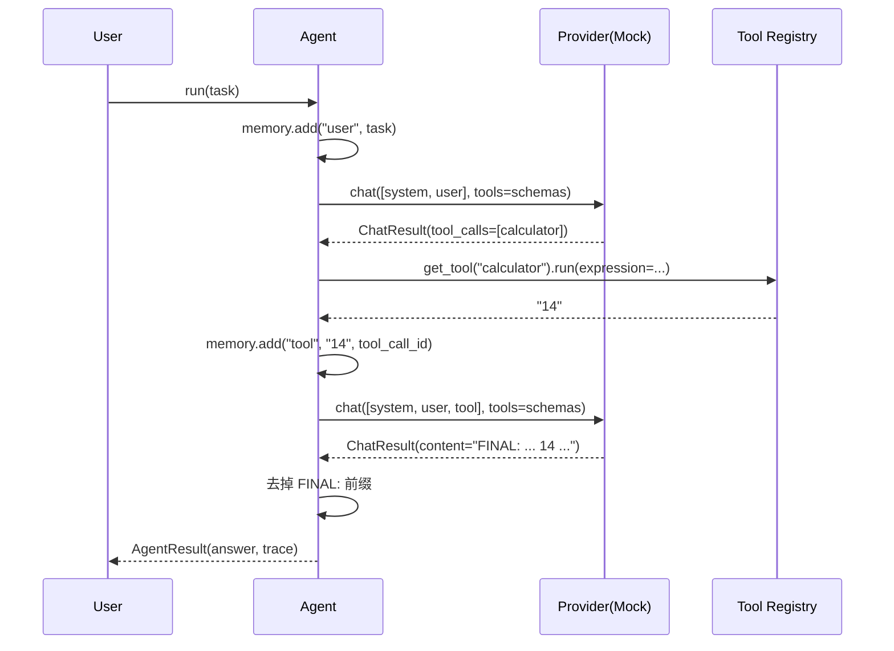
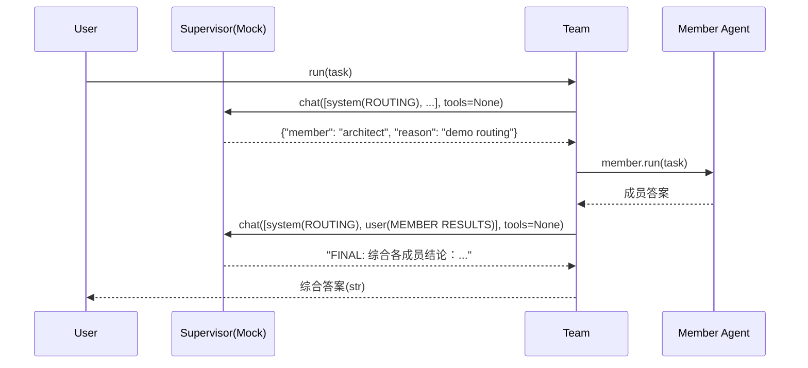

# AgentForge 架构说明

本文档说明 AgentForge 的模块依赖、数据流、编排时序与扩展点。

---

## 1. 模块依赖

```mermaid
graph TD
    CLI[cli.py] --> Agent
    CLI --> Team
    Examples[examples/*] --> Agent
    Examples --> Team

    Agent --> Provider
    Agent --> Tool
    Agent --> Memory
    Agent --> Events
    Team --> Agent
    Team --> Provider
    Team --> Events

    Tool --> Provider[core.provider: Message/ToolCall/ChatResult]
    Memory --> Provider

    Providers[providers/*] -->|继承| Provider
    Tools[tools/builtin] -->|@tool 装饰| Tool

    classDef core fill:#eef,stroke:#88a;
    class Agent,Team,Tool,Memory,Events,Provider core;
```

- `core.provider` 是叶子模块（仅依赖标准库），定义了 `Message` / `ToolCall` / `ChatResult` / `Provider` / 注册表。
- `core.tool` 也是叶子模块，定义 `Tool` 与 `@tool`、全局注册表 `TOOLS`。
- `core.memory` 仅依赖 `provider.Message`。
- `core.events` 独立，供 Agent / Team 用于可观测。
- `core.agent` 组合 Provider / Tool / Memory / Events。
- `core.team` 组合 Agent / Provider / Events。
- `providers.*` 与 `tools.*` 各自依赖 `core`，互不依赖，无循环。

---

## 2. ReAct 循环数据流（时序）



关键 invariant：
- 工具调用结果以 `role="tool"` 的 `Message`（带 `tool_call_id`）写回 memory。
- 每轮 emit `agent.thought`；调用工具时 emit `tool.call` / `tool.result`；结束时 emit `agent.done`。
- 受 `max_iterations` 限制，避免无限循环。

---

## 3. Team 编排时序



说明：
- Supervisor 的 system prompt 含 `ROUTING` 与成员列表（bullets）。
- 首次路由返回某个 `member`；当 messages 中出现 `MEMBER RESULTS` 标记时，Mock 返回 `FINAL:` 综合答案。
- 受 `max_rounds` 限制；超过则 Team 直接汇总已收集结果。

---

## 4. 扩展点

### 4.1 新增 Provider
```python
from agentforge.core.provider import Provider, ChatResult, Message, ToolCall, register_provider

class MyProvider(Provider):
    def chat(self, messages, tools=None, **kwargs):
        # 调用你的后端，返回 ChatResult(...)
        ...

register_provider("my", MyProvider)
```
注意：真实 SDK 应**惰性导入**（在 `chat` 内部 `import`），以便类可被注册而无需安装 SDK。

### 4.2 新增 Tool
```python
from agentforge.core.tool import tool

@tool
def weather(city: str) -> str:
    """查询城市天气。"""
    return f"{city}: sunny"
# 自动注册到 TOOLS，可被 Agent 通过名字引用
```

### 4.3 替换 Memory
继承 `MemoryStore`，重写 `add` / `history` / `remember` / `recall` / `clear`，
或直接将自定义实例传给 `Agent(memory=...)`，即可接入向量库 / SQL / Redis。

### 4.4 自定义可观测
传入自己的 `EventBus` 到 `Agent(... event_bus=bus)` 或 `Team(... event_bus=bus)`，
订阅 `agent.start` / `agent.thought` / `tool.call` / `tool.result` / `agent.done` / `team.route`
事件，把 trace 发往日志、UI 或 OpenTelemetry。

---

## 5. 设计原则
1. **Provider 是唯一与 LLM 对话的边界**，其余完全无关。
2. **Mock 永远可用**：保证示例、测试、教学零密钥可跑，降低开源传播门槛。
3. **约定优于配置**：`@tool` 自动注册，`get_provider` 按名取类。
4. **可观测是一等公民**：事件总线默认开启，而非事后补丁。
